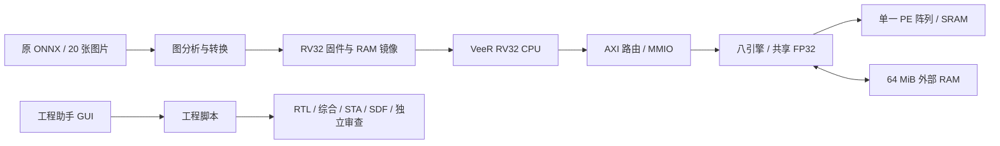

# Qingruan：RISC-V 与 PE 工程助手

将任务一工程、Swin-Tiny 模型转换、PE 阵列与非 MAC 加速器开发、RTL/综合/门级验证脚本和图形界面整理在同一个源码仓库，便于队友接手开发与复现。

**截至 2026-11-11：任务一在记录的工程条件通过；新向量流水候选已完成首张图的真实 RV32 整机推理与 22 命令整机门级回归。任务二尚未通过最终验收。** 公开参考 Top-1 仍只有 3/5 一致，20 图验证和原始完整 PE 基线尚未全部结束，最终选型保持开放。

- [交接总说明](docs/HANDOFF.md)：环境、关键文件作用、C/RTL/MMIO 接口、完成证据和接续任务。
- [文件逐项说明](docs/FILE_GUIDE.md)：1,113 项历史源码、脚本、配置的用途与实际接口声明；包含原工作区中未随仓库上传的文件，开头已标明范围。
- [优化实施方案](docs/OPTIMIZATION_PLAN.md)、[GUI 移植说明](docs/GUI_MIGRATION.md)。
- [验证证据索引](evidence/index.json)：原始审查摘要的位置与 SHA256；[交接时状态快照](evidence/status/handoff-snapshot.json)。GitHub 快照不会自动随本机仿真更新。

## 功能与系统结构

- Ubuntu 本机 Tk GUI：步骤目录、工具检测、任务启动/停止、日志、历史记录和波形入口。
- 原任务一：PE/阵列/AXI/CPU 整机 RTL、固件、综合约束和 SDF 验证流程。
- Swin-Tiny：原 ONNX 分析、固定形状内存计划、图描述和权重序列化、C 调度器、RV32 固件。
- 加速器：原生仿射 INT8 MAC 阵列、DMA，以及 COPY、GELU、GEMM、QUANT、Softmax、LayerNorm、VECTOR、REORDER 八引擎。
- 独立向量流水候选：保持逐步 FP32 舍入与共享除法通路，使用操作数 FIFO 重叠 SRAM 读取。
- 三套已独立验证过的可移动复现组件：RTL 编译依赖闭包、固件/20 图输入数据、原 ONNX 转换。



## 目录

```text
.
├── native/contest-gui/       # 已移植的图形界面和步骤配置
├── native/swin-tiny/         # ONNX、调度计划、原 C 图与 PE 驱动
├── native/optimization/
│   ├── rtl/                 # PE、DMA、八引擎及共享资源
│   ├── c/                   # MMIO、命令计划/派发、裸机入口
│   ├── tests/               # RTL/AXI/完整图监视器与故障对照
│   ├── variants/vecpipe_v1/  # 独立向量流水候选
│   └── vendor/              # HardFloat、Newlib 参考源及许可
├── native/audits/20261107/riscv_pe_contest/contest/task1/
│                            # 已核对的任务一源码、VeeR、库模型和流程
├── competition/             # 选定 Swin ONNX、20 图、原预处理与公开参考
├── repro/rtl/               # 可移动 RTL 依赖闭包，113 个校验文件
├── repro/inference/         # 固件/输入/数据复现，96 个校验文件
├── repro/conversion/        # 原模型转换复现，14 个校验文件
├── evidence/                # 历史验证摘要与明确标注的状态快照
├── docs/                    # 交接和接口文档
└── tools/                   # 仓库离线检查、复用本机既有环境
```

这是源码与必要输入的仓库，不含已安装的商业 EDA、许可证/密钥、虚拟机磁盘、旧 AircraftCNN 训练集、仿真可执行文件或 GB 级波形/网表/SDF。`repro/inference` 中的固定参考固件和模型数据是复现输入，按清单保留。三个组件分别完成过复现，仍不等于最终一体交付或官方精度通过。

## 快速开始

### 1. 克隆与离线检查

需要 Python 3.11 或更高版本。离线检查只使用标准库，不调用 EDA 或启动仿真。

```bash
git clone https://github.com/N1N1N1no/Qingruan.git
cd Qingruan
python3 tools/check_repository.py
```

本次发布前已在独立仓库目录实际验证：113个RTL依赖文件、96个固件/数据输入文件哈希一致；RV32固件重编的bin/hex及符号一致；原ONNX转换的15项工件一致。记录见[发布目录验证](evidence/repository-validation.json)。这些检查没有重跑硬件仿真。

检查内容：三个复现组件的完整哈希闭包、选定模型与20图的提供方校验、归档证据哈希、Python语法及主要文档链接。通过只表示仓库输入完整，不能替代硬件和精度验收。

`competition/SHA256SUMS` 保留提供方原清单，其中另外四个模型未随本仓库上传；检查器明确仅跳过这四个未选择的模型。`official_preprocess.py` 保留本机现有原字节，来源限制见“已知问题”。

### 2. 在当前本机复用已有环境

若接手的是现有 `/mnt/data/Ubuntu/qingruan` 工作区，无需重新下载、解压或安装工具。源码仓库通过本机符号链接使用现有运行环境：

```bash
python3 tools/link_local_runtime.py --workspace /mnt/data/Ubuntu/qingruan
./run-native.sh --no-license /usr/bin/python3 --version
./启动工程助手.sh
```

该脚本只连接已安装的 rootfs、Python 依赖、库缓存和许可服务运行目录，**不会连接原工程的运行中 `work/`**。链接与 `local-runtime.json` 已忽略，不会上传。不要在原环境被删除后继续依赖这些链接。

`run-native.sh` 使用本机 Linux 内核与 CPU，通过 bwrap 加载既有 Ubuntu 20.04 兼容运行库。环境内 `/workspace` 映射当前仓库。GUI 使用宿主 `/usr/bin/python3` 与 Tk；商业 EDA 按现有配置连接许可服务。原许可虚拟机只提供许可，工程计算在本机。

新机器需自行准备合法可用的 VCS/DC/PT、RISC-V GCC 和等效 Python/库环境，或另行搬迁本机运行环境；仓库没有通用的一键商业工具安装器。

### 3. 运行常用入口

```bash
./Swin-Tiny.sh analyze      # 原模型与 MAC 映射分析
./Swin-Tiny.sh reference    # 公开参考比较；当前会如实报告不一致
./Swin-Tiny.sh plan         # plan.json / graph.bin / constants.bin
./Swin-Tiny.sh verify       # 主机 C 调度与固件构建
./Swin-Tiny.sh rtl          # 代表性 RV32/PE RTL 测试
```

上述五步是早期 GUI 桥接流程，`verify` 不是完整硬件推理证明，`rtl` 也不是完整20图推理。八引擎/流水完整推理入口和依赖顺序见[交接说明](docs/HANDOFF.md)及各脚本参数。多数优化实验依赖前置阶段的 `work/` 结果；本仓库保留源码与审查摘要，未复制所有历史运行目录，不能假定任意脚本都能从空结果目录直接启动。

每次运行使用新输出目录/未使用的 `--revision`。不要覆盖已有结果、修改运行中冻结源码，或因缺少 `summary.json` 就重复启动仍在计算的 simv。

### 4. 独立组件复现

在本机已连接环境后，验证无需 EDA：

```bash
./run-native.sh --no-license /home/zhz/miniforge3/bin/python3 \
  /workspace/repro/rtl/replay_compile.py verify
./run-native.sh --no-license /home/zhz/miniforge3/bin/python3 \
  /workspace/repro/inference/inference_replay.py verify
```

RTL 编译会实际调用 VCS，需要已有许可；仅编译，不执行完整模型：

```bash
./run-native.sh /home/zhz/miniforge3/bin/python3 \
  /workspace/repro/rtl/replay_compile.py compile --output runs/compile-github-v1
```

原 ONNX 转换使用已固定的 Python 依赖，每个干净副本只运行一次，生成目录被 Git 忽略：

```bash
./run-native.sh --no-license /usr/bin/env \
  PYTHONPATH=/workspace/native/swin-tiny/runtime \
  /home/zhz/miniforge3/envs/task2-cnn/bin/python -B \
  /workspace/repro/conversion/replay_conversion.py
```

固件重编、预处理和20图RAM段校验见 [固件组件 README](repro/inference/README.md)；RTL 和转换分别见 [RTL README](repro/rtl/README.md)、[转换 README](repro/conversion/README.md)。组件内清单和源码保持已验证字节，不做全局路径替换。

## 环境与接口

|项目|当前记录|
|---|---|
|RV32编译|xPack GCC 14.2.0-3；`rv32imc_zicsr` / `ilp32`，禁用浮点FMA收缩|
|Python模型工具|Python 3.11、NumPy 1.26.4、ONNX 1.19.1、ORT 1.23.2；[依赖锁文件](native/swin-tiny/requirements.lock)|
|EDA记录|VCS L-2016.06，DC L-2016.03-SP1；原库/角/约束按各次清单|
|模型|原 Swin-Tiny INT8 Q/DQ ONNX，输入FP32 `[1,3,224,224]`，输出 `[1,1000]`|
|RAM|`0x80000000..0x83ffffff`，逻辑64MiB外部RAM|
|原PE接口|MMIO `0x90000000`|
|新增统一加速器|MMIO `0x90001000`，16个32位参数槽，间距8字节|
|总线|32位地址、64位AXI数据；valid/ready握手与取消排空|
|比较条件|10ns时钟、0.1ns不确定度、同库/同IO/同存储边界；10ns为工程比较条件|

opcode 1..8分别为 COPY、GELU、GEMM、QUANT、Softmax、LayerNorm、VECTOR、REORDER。参数、错误/超时/取消语义以 [accel_io.h](native/optimization/c/accel_io.h)、[accel_io.c](native/optimization/c/accel_io.c)、[axi_accel_mmio.sv](native/optimization/rtl/axi_accel_mmio.sv) 为准；完整端口和数据布局见[交接接口说明](docs/HANDOFF.md#6-软件硬件接口约定)。

## 已完成的工程测量

同一首图 `ILSVRC2012_val_00000274.JPEG`、同10ns条件。四案均实际运行完整RV32＋八引擎，1000个FP32输出与冻结C逐字节一致，Top-1=607。

|候选|完整推理周期|硬件时间|完整SoC面积¹|相对标量R8_C16的ADP|
|---|---:|---:|---:|---:|
|R8_C16_L4 / 向量流水|653,393,986|6.53393986s|2,114,649.956611|0.660996244|
|R8_C16_L4 / 标量|1,000,484,499|10.00484499s|2,089,316.648438|1.000000000|
|R16_C8_L4 / 标量|1,046,957,093|10.46957093s|2,171,889.432457|1.087807294|
|R8_C32_L4 / 标量|949,222,155|9.49222155s|3,530,648.246685|1.603273774|

¹ 面积按相同库报告单位，含CPU、路由、MMIO、八引擎、一个阵列及其SRAM；外部64MiB逻辑RAM不计入该共同顶层边界。计时包含推理中的搬运、RV32调度、计算和最终输出形成，不是宿主机仿真墙钟。

新流水相对同几何标量：首图完整延迟降低约34.69%，面积增加约1.21%，ADP降低约33.90%。这是固定首图与已测四案的工程比较，不能作为20图平均性能、全局最优或满足官方精度后的最终选择。

对应[完整首图独立审查](evidence/optimization/work/vecpipe-complete-candidate-review-v1/summary.json)、[三个标量控制比较](evidence/optimization/work/complete-three-controls-v1/summary.json)。原任务一的记录条件验收见[任务一摘要](evidence/task1/audit-summary.json)。

新流水[完整SoC门级22命令审查](evidence/optimization/work/vecpipe-full-soc-gate/v1/summary.json)已通过：RTL/门级结果和CPU调用/引擎周期一致，完整MAXIMUM SDF反标，正常无时序违反，CPU检出故意输出破坏，真实100fs时序负对照触发违反。**这不是完整20图门级推理、形式等价或物理签核。**

## 已知问题与接续工作

1. **官方精度未通过。** 五张公开图主办方Top-1为607/853/488/480/459；冻结C及已完成的真实RV32为607/853/488/707/578，仍只有3/5。本机原ONNX CUDA也稳定3/5，不据此更换标签、模型、预处理或放宽容差。
2. **预处理来源有边界。** 当前脚本与已有本地比赛zip成员一致，用户未改动；它不在提供方SHA256SUMS中，官方来源仍未认证。当前Swin短边248/BILINEAR/中心224，不能擅自按经验改成其他配置。
3. **完整20图未验收。** 导出时首图通过，其余19图已有8张终态（7张冻结C逐位通过、1张失败），4张仍计算、7张排队。状态是本机时间快照，见[队列快照](evidence/status/queue-at-export.json)。
4. **私有图片759数值失败。** 实际RV32完整输出与此前Newlib模型诊断逐字节一致，但917个logit字不等于冻结C；已知差异从Softmax浮点经1字节量化差异传播，仍需逐节点定位与修复。保留[失败记录](evidence/optimization/work/vecpipe-images-rv32-v1/ILSVRC2012_val_00000759.JPEG/failure.json)。
5. **原始完整PE性能基线仍运行。** 不能用前缀或静态MMIO数量估算最终加速比。原VCS与4个图片任务的父调度退出后已补收集/续跑入口；接管进程的退出码不可恢复时明确记录null，不伪造成功退出。
6. **最终交付待闭环。** 完成全部数值/官方精度、原基线、同条件完整ADP选择后，组装并验证一体交付包，再切入GUI默认候选。当前三个独立复现组件不替代该验收。

下一位队友优先按[交接待办表](docs/HANDOFF.md#9-接下来按顺序做什么)继续。旧AircraftCNN示例与原任务一smoke都有各自适用范围，不能代替Swin完整推理或精度证明。

## 第三方代码与更新

VeeR、HardFloat、Newlib及库资料保留各自来源/许可声明，见 [第三方说明](THIRD_PARTY_NOTICES.md)。商业工具和许可内容不在仓库内。

后续提交只纳入源码、必要输入和注明日期/范围的证据摘要。`work/`、`runs/`、`results/`及本机环境已忽略；运行后先执行 `git status --short` 与 `python3 tools/check_repository.py`，确认结果和未通过项仍如实记录，再提交。
